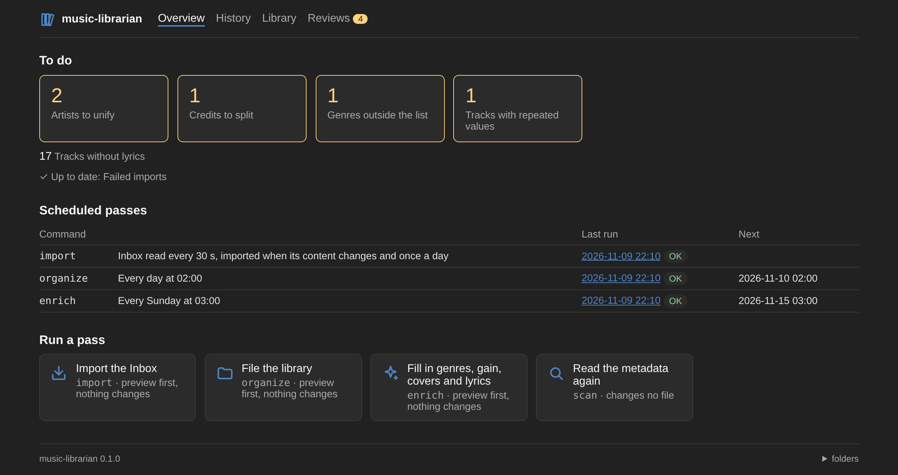
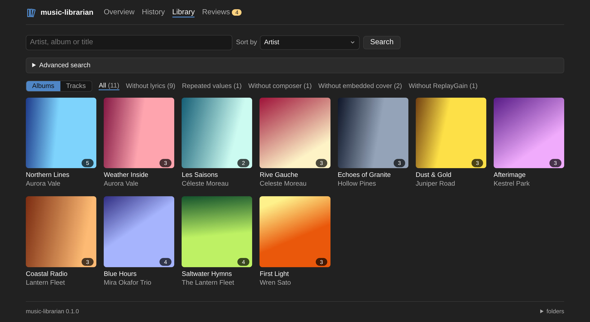
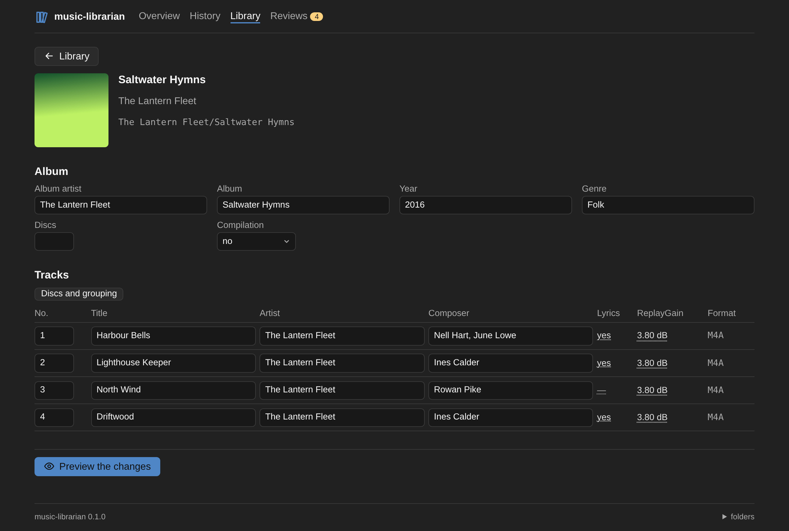
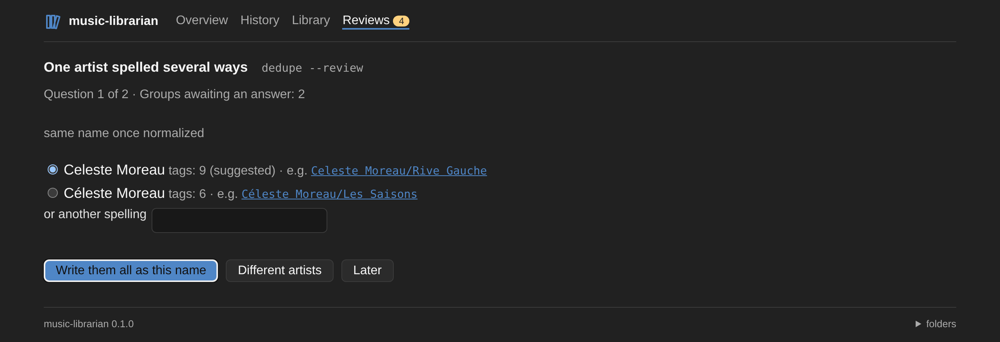
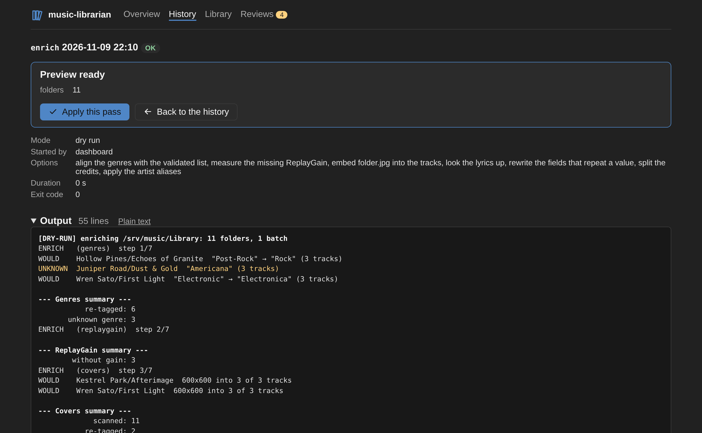

# music-librarian

[English](README.md) · **Français**

Range une bibliothèque musicale à la façon d'Apple Music, et y importe la musique déposée dans un dossier d'arrivée. Pensé pour une bibliothèque en ALAC `.m4a` avec quelques MP3, il tourne dans un seul conteneur Docker qui surveille le dossier d'arrivée, range ce qui y arrive et complète ce qui manque aux tags, avec un dashboard pour le suivre et le piloter.

Tout est en dry-run sans `--apply`, et chaque changement est journalisé : tout passage peut être annulé.



## Fonctionnalités

- **Range la bibliothèque** en `Artiste de l'album/Album/NN Titre.ext`, avec les règles d'Apple Music pour les compilations, les albums multi-disques et les caractères interdits, sans renommer ce qui est déjà en place.
- **Importe l'Inbox** : FLAC converti en ALAC, rangement en tout-ou-rien, originaux gardés 7 jours.
- **Enrichit les tags** : genres alignés sur une liste validée, ReplayGain, pochette intégrée, paroles depuis LRCLIB et NetEase.
- **Nettoie les crédits** : `John Lennon/Paul McCartney` découpé en `John Lennon; Paul McCartney` pour Lyrion, et un même artiste écrit de plusieurs façons (`Beyonce` / `Beyoncé`) unifié.
- **Modifie tags et pochettes** en ligne de commande ou depuis le dashboard, puis range les pistes là où leurs nouveaux tags les placent.
- **Garde l'historique de Lyrion** : les lectures et notes suivent les fichiers qu'il déplace (en option).
- **Un dashboard bilingue** (français, anglais) pour suivre les passages en direct, chercher dans la bibliothèque, éditer un album et répondre aux questions que les outils ne tranchent pas seuls.

## Captures d'écran

| Bibliothèque | Album |
|---|---|
|  |  |
| **Revues** | **Un passage** |
|  |  |

## Démarrage rapide

Docker est la voie prévue : ffmpeg est dans l'image, et les tests tournent au build.

```bash
cp .env.example .env      # chemins de la bibliothèque, de l'Inbox et (facultatif) de Lyrion
mkdir state               # à créer avant le premier lancement
docker compose up -d      # watch --apply, rangement chaque nuit, enrichissement le dimanche, dashboard sur :8080
```

Le fichier compose construit l'image ; pour utiliser l'image publiée, remplacer sa section `build:` et sa ligne `image:` par `image: ghcr.io/werdeil/music-librarian:latest` (ou une version comme `0.1`, ou `dev` pour suivre `main`), pour amd64 et arm64. La bibliothèque et l'Inbox doivent se trouver sous le dossier unique de `MUSIC_LIBRARIAN_VOLUME`, monté au même chemin que sur l'hôte. Journaux : `journalctl -t music-librarian -f`.

Sans Docker : Python 3.12, ffmpeg dans le `PATH`, `pip install .`, puis `music-librarian {commande} --help`.

## Commandes

| Commande | Ce qu'elle fait |
|---|---|
| `watch` | Le processus du conteneur : importe ce qui arrive dans l'Inbox, lance les passages programmés, sert le dashboard (`--listen`) |
| `import` | Convertit et range ce qui a été déposé dans l'Inbox, puis l'enrichit |
| `organize` | Range la bibliothèque d'après ses tags, les annexes (`folder.jpg`, livrets, `.lrc`) suivant leur album |
| `enrich` | Complète ce qui manque ou cloche : genres, ReplayGain, pochette, paroles, valeurs en double |
| `scan` | Lit les tags de la bibliothèque dans le cache des métadonnées où les autres commandes les lisent |
| `split` | Découpe les compositeurs et artistes qui regroupent plusieurs noms (`--review` pour trancher les cas douteux) |
| `dedupe` | Unifie un même artiste écrit de plusieurs façons (`--review` pour répondre groupe par groupe) |
| `tag` | Réécrit des champs des pistes ou des albums, puis les range de nouveau |
| `cover` | Remplace le `folder.jpg` d'un album et l'intègre à ses pistes |
| `undo` | Rejoue le journal d'un passage à l'envers |

Lancements ponctuels, en dry-run sans `--apply` :

```bash
docker compose run --rm music-librarian enrich
docker compose run --rm music-librarian tag "/srv/music/Library/Beyonce/4" --set albumartist=Beyoncé
docker compose run --rm music-librarian dedupe --review
docker compose run --rm music-librarian undo /state/journal/{date}.jsonl --apply
```

Chaque commande, ses options et ses règles sont détaillées dans [docs/commands.md](docs/commands.md) (en anglais).

## Configuration

| Variable | Rôle |
|---|---|
| `MUSIC_LIBRARIAN_ROOT` | Racine de la bibliothèque (`--root`) |
| `MUSIC_LIBRARIAN_INBOX` | Dossier de dépôt, hors de la bibliothèque pour qu'un serveur de musique ne l'indexe pas (`--inbox`) |
| `MUSIC_LIBRARIAN_STATE` | Journaux, date du dernier passage, verrou, cache des métadonnées, historique des passages, décisions de découpage des crédits et alias d'artistes (`--state-dir` ; `/state` dans l'image, `~/.local/state/music-librarian` sinon) |
| `LYRION_PERSIST_DB`, `LYRION_MUSIC_ROOT` | `persist.db` de Lyrion et racine de la bibliothèque vue par Lyrion ; sans eux, l'historique n'est pas reporté |
| `LYRICS_PROVIDERS` | Fournisseurs de paroles essayés dans l'ordre (défaut `lrclib,netease` ; vide pour ne chercher aucunes paroles, voir [les fournisseurs](docs/commands.md#lyrics-providers), en anglais) |
| `MUSIXMATCH_TOKEN`, `LRCLIB_TIMEOUT` | Réglages facultatifs des fournisseurs |
| `LYRICS_RETRY_DAYS` | Jours avant de rechercher à nouveau les paroles d'une piste restée sans résultat (défaut `30`, `0` pour chercher à chaque passage) |
| `MUSIC_LIBRARIAN_GENRES` | Liste des genres validés (défaut `genres.txt` dans le dossier d'état, voir [les genres](docs/commands.md#genres), en anglais) |
| `GENRE_LOOKUP`, `ITUNES_COUNTRY` | `itunes` pour chercher les genres que la liste ne sait pas aligner (activé dans le fichier compose), et le magasin interrogé (défaut `us`) |
| `MUSIC_LIBRARIAN_LISTEN` | Adresse du dashboard, `[HÔTE:]PORT` (`watch --listen` ; le fichier compose fixe `8080`, et `WEB_PORT` le port de l'hôte) |
| `MUSIC_LIBRARIAN_WEB_HOSTS` | Noms par lesquels on atteint le dashboard, séparés par des virgules, en plus d'une adresse IP, d'un nom sans point et des suffixes locaux `.local`, `.lan`, `.home`, `.home.arpa`, `.internal` (`watch --web-hosts`) |

Le fichier compose lit ses propres variables dans `.env` ; `.env.example` les documente. Pour aligner les genres, copier [`genres.example.txt`](genres.example.txt) en `state/genres.txt` et l'adapter.

## Sécurité

Le dashboard n'a pas d'authentification, par choix : quiconque atteint son port voit les chemins de la bibliothèque, l'Inbox et la sortie de chaque passage, et peut lancer n'importe quelle commande sur la bibliothèque. Gardez-le sur le réseau de la maison : pas de redirection de port, pas de reverse proxy public. Pour y accéder de l'extérieur, rejoignez le réseau par un VPN comme WireGuard ou Tailscale. Un autre site ne peut pas l'atteindre par un nom à lui (DNS rebinding) : le dashboard ne répond qu'à une adresse IP, à un nom local et aux noms de `MUSIC_LIBRARIAN_WEB_HOSTS` ; détails dans [docs/web.md](docs/web.md#security) (en anglais).

## Documentation

En anglais :

- [Commandes](docs/commands.md) : ce que fait chaque commande, la liste des genres et les fournisseurs de paroles
- [Dashboard](docs/web.md) : ses pages, les états d'un passage, et ses routes
- [Règles de nommage](docs/naming-rules.md) : construction des chemins cibles, et quand un fichier est considéré en place
- [Découpage des crédits](docs/splitting.md) : quels compositeurs et artistes sont découpés, et le fichier de décisions
- [Unification des noms d'artistes](docs/dedupe.md) : quels noms sont regroupés, et le fichier d'alias
- [Report de l'historique Lyrion](docs/lyrion.md)
- [Architecture](docs/architecture.md) : organisation du paquet et déroulé de chaque commande, étape par étape

## Développement

```bash
pip install -r requirements-dev.txt -e .
python -m pytest -q    # demande ffmpeg
pylint src tests
```

Voir [CONTRIBUTING.md](CONTRIBUTING.md) avant d'ouvrir une pull request, et les [releases](https://github.com/werdeil/music-librarian/releases) pour les changements entre versions (en anglais).

## Licence

[MIT](LICENSE)
