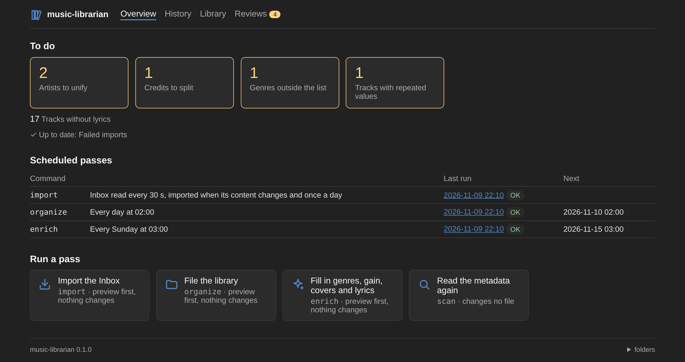
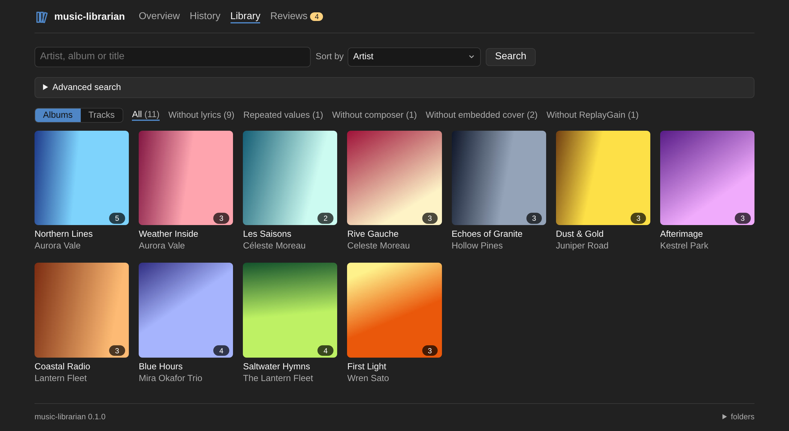
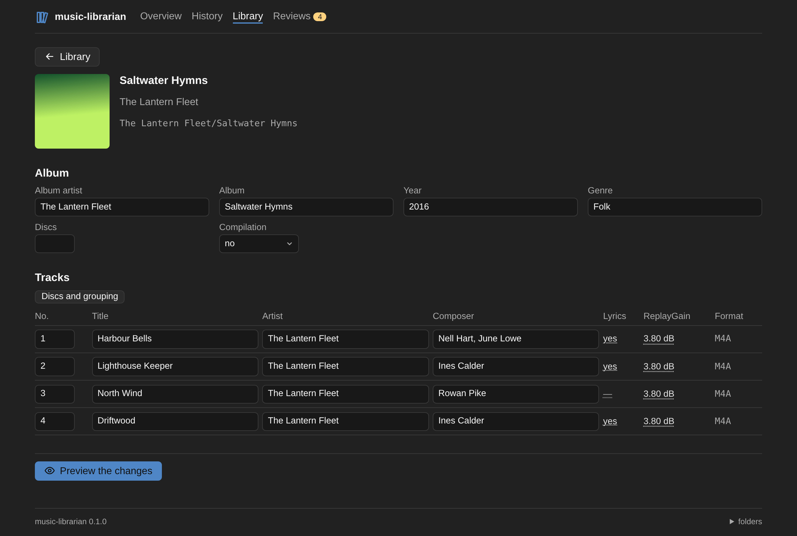
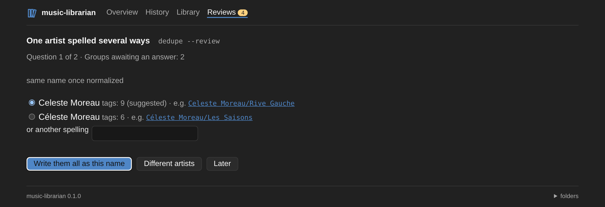
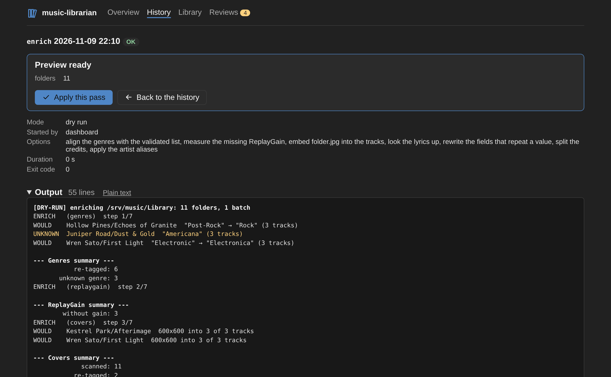

# music-librarian

**English** · [Français](README.fr.md)

Keeps a music library filed the way Apple Music does, and imports new music into it from a drop folder. Made for ALAC `.m4a` libraries with some MP3, it runs as a single Docker container that watches the drop folder, files what lands there and fills in what the tags are missing, with a dashboard to follow and drive it.

Everything is a dry run unless `--apply` is passed, and every change is journaled, so any pass can be undone.



## Features

- **Files the library** as `Album Artist/Album/NN Title.ext`, with Apple Music's rules for compilations, multi-disc albums and forbidden characters, without renaming what is already in place.
- **Imports the Inbox**: FLAC converted to ALAC, files filed all-or-nothing, originals kept for 7 days.
- **Enriches the tags**: genres aligned with a validated list, ReplayGain, embedded cover, lyrics from LRCLIB and NetEase.
- **Cleans the credits**: `John Lennon/Paul McCartney` split into `John Lennon; Paul McCartney` for Lyrion, and one artist spelled several ways (`Beyonce` / `Beyoncé`) unified.
- **Edits tags and covers** from the command line or the dashboard, then files the tracks where their new tags put them.
- **Keeps Lyrion's history**: play counts and ratings follow the files it moves (optional).
- **A bilingual dashboard** (English, French) to follow the passes live, search the library, edit an album and answer the questions the tools cannot settle alone.

## Screenshots

| Library | Album |
|---|---|
|  |  |
| **Reviews** | **A pass** |
|  |  |

## Quick start

Docker is the intended way: ffmpeg comes with the image, and the tests run during the build.

```bash
cp .env.example .env      # set the library, Inbox and (optionally) Lyrion paths
mkdir state               # must exist before the first start
docker compose up -d      # watch --apply, organize nightly, enrich on Sundays, dashboard on :8080
```

The compose file builds the image; to use the published one, replace its `build:` section and `image:` line with `image: ghcr.io/werdeil/music-librarian:latest` (or a version such as `0.1`, or `dev` to follow `main`), for amd64 and arm64. The library and the Inbox must sit under the single folder set in `MUSIC_LIBRARIAN_VOLUME`, mounted at the same path as on the host. Logs: `journalctl -t music-librarian -f`.

Without Docker: Python 3.12, ffmpeg on `PATH`, `pip install .`, then `music-librarian {command} --help`.

## Commands

| Command | What it does |
|---|---|
| `watch` | The container's process: imports what lands in the Inbox, runs the scheduled passes, serves the dashboard (`--listen`) |
| `import` | Converts and files what was dropped in the Inbox, then enriches it |
| `organize` | Files the library by its tags, side files (`folder.jpg`, booklets, `.lrc`) following their album |
| `enrich` | Fills what is missing or off: genres, ReplayGain, cover, lyrics, repeated values |
| `scan` | Reads the library's tags into the metadata cache the other commands read from |
| `split` | Splits the composer and artist credits holding several names (`--review` to settle the doubtful ones) |
| `dedupe` | Unifies one artist spelled several ways (`--review` to answer each group) |
| `tag` | Rewrites tag fields of tracks or albums, then files them again |
| `cover` | Replaces an album's `folder.jpg` and embeds it into its tracks |
| `undo` | Replays a pass's journal in reverse |

One-off runs, dry run unless `--apply` is added:

```bash
docker compose run --rm music-librarian enrich
docker compose run --rm music-librarian tag "/srv/music/Library/Beyonce/4" --set albumartist=Beyoncé
docker compose run --rm music-librarian dedupe --review
docker compose run --rm music-librarian undo /state/journal/{date}.jsonl --apply
```

Each command, its options and its rules are detailed in [docs/commands.md](docs/commands.md).

## Configuration

| Variable | Purpose |
|---|---|
| `MUSIC_LIBRARIAN_ROOT` | Library root (`--root`) |
| `MUSIC_LIBRARIAN_INBOX` | Drop folder, outside the library so a music server does not index it (`--inbox`) |
| `MUSIC_LIBRARIAN_STATE` | Journals, last run date, lock, metadata cache, run history, the credit split decisions and the artist aliases (`--state-dir`; `/state` in the image, `~/.local/state/music-librarian` otherwise) |
| `LYRION_PERSIST_DB`, `LYRION_MUSIC_ROOT` | Lyrion's `persist.db` and the library root as Lyrion sees it; history carry-over is off without them |
| `LYRICS_PROVIDERS` | Lyrics providers tried in order (default `lrclib,netease`; empty to look up no lyrics, see [the providers](docs/commands.md#lyrics-providers)) |
| `MUSIXMATCH_TOKEN`, `LRCLIB_TIMEOUT` | Optional provider settings |
| `LYRICS_RETRY_DAYS` | Days before a track whose lyrics were not found is looked up again (default `30`, `0` to look it up on every pass) |
| `MUSIC_LIBRARIAN_GENRES` | Validated genre list (default `genres.txt` in the state folder, see [genres](docs/commands.md#genres)) |
| `GENRE_LOOKUP`, `ITUNES_COUNTRY` | `itunes` to look up the genres the list cannot align (on in the compose file), and the store asked (default `us`) |
| `MUSIC_LIBRARIAN_LISTEN` | Address of the dashboard, `[HOST:]PORT` (`watch --listen`; the compose file sets `8080`, and `WEB_PORT` the host's port) |
| `MUSIC_LIBRARIAN_WEB_HOSTS` | Names the dashboard is reached by, comma-separated, besides an IP address, a name without a dot and the local suffixes `.local`, `.lan`, `.home`, `.home.arpa`, `.internal` (`watch --web-hosts`) |

The compose file reads its own variables from `.env`; `.env.example` documents them. To align genres, copy [`genres.example.txt`](genres.example.txt) to `state/genres.txt` and adapt it.

## Security

The dashboard has no authentication, by design: anyone who can reach its port sees the library's paths, the Inbox and the output of every pass, and can run any command on the library. Keep it on the home network: no port forwarding, no public reverse proxy. For remote access, join the network through a VPN such as WireGuard or Tailscale. Another website cannot reach it through a name of its own (DNS rebinding): the dashboard answers only to an IP address, a local name and the names of `MUSIC_LIBRARIAN_WEB_HOSTS`; details in [docs/web.md](docs/web.md#security).

## Documentation

- [Commands](docs/commands.md): what each command does, the genre list and the lyrics providers
- [Dashboard](docs/web.md): its pages, the statuses of a run, and its routes
- [Naming rules](docs/naming-rules.md): how target paths are built, and when a file counts as in place
- [Splitting credits](docs/splitting.md): which composer and artist credits are split, and the decisions file
- [Unifying artist names](docs/dedupe.md): which names are grouped, and the aliases file
- [Lyrion history carry-over](docs/lyrion.md)
- [Architecture](docs/architecture.md): the package layout and how each command runs, step by step

## Development

```bash
pip install -r requirements-dev.txt -e .
python -m pytest -q    # needs ffmpeg
pylint src tests
```

See [CONTRIBUTING.md](CONTRIBUTING.md) before opening a pull request, and the [releases](https://github.com/werdeil/music-librarian/releases) for what changed between versions.

## License

[MIT](LICENSE)
